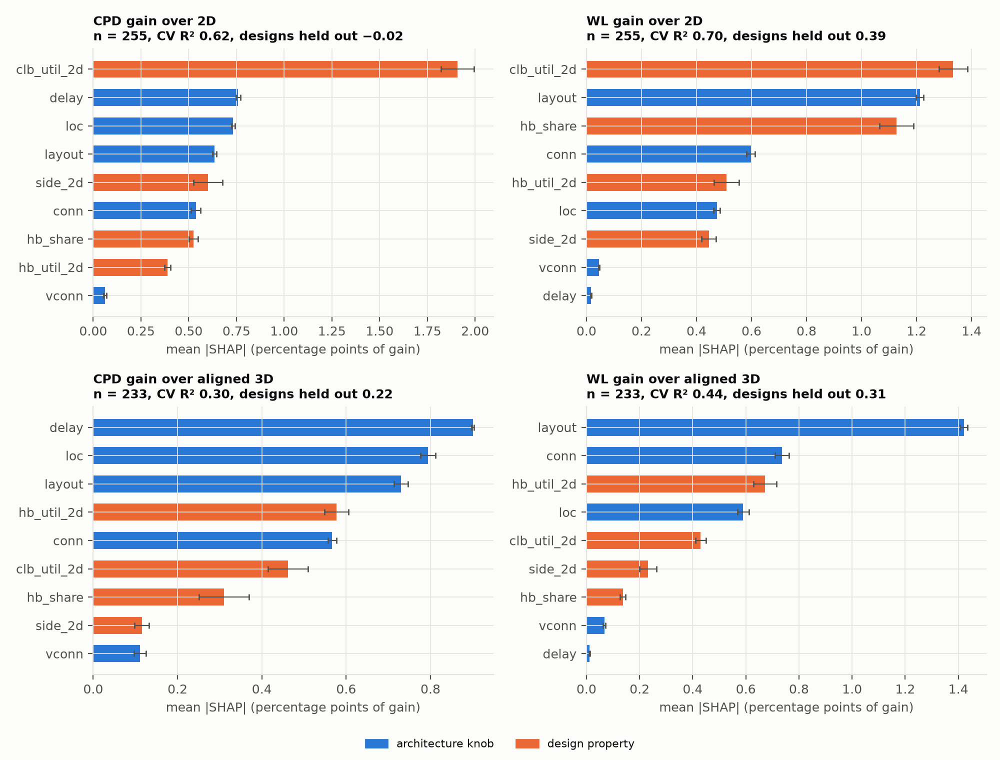

# SHAP view of the 3D architecture study

Which architecture knobs, and which properties of the design, explain the 3D gains in the
final study (STUDY_RESULTS.md, 279 runs in `docs/study/results/`)? This applies
`lazagna_shap.py` to one table of all the routed runs. It runs locally, in about half a minute,
from the versioned results. The generated tables are in `shap_tables.md`.

## Data

`study_runs.csv` has one row per routed 3D configuration of a design: 255 rows over 22 designs.
- Kinds: rq1 22, layout 140, conn 84 and custom 9.
- 24 runs are dropped as duplicates: 6 explicit `aligned` layout runs are bit-identical to the
  rq1 3D runs, and 18 10-seed confirmations repeat a 5-seed configuration.

Each row carries:
- **Knobs:**
  - `layout`: `aligned` for the rq1 and conn runs; `searched` for the Optuna layouts re-run
    at 5 seeds.
  - `conn`: share of switch blocks that are 3D (p).
  - `vconn`: share of their channels that cross (v).
  - `loc`: where the 3D switch blocks are.
  - `delay`: inter-layer delay ratio.
- **Design properties**, from the design's rq1 sizing, as in the RQ1 table of `tables.md`:
  - `hb_share`: hard-block share of the used tiles;
  - `side_2d`: the 2D device's side;
  - `clb_util_2d`: CLB utilization on the 2D device;
  - `hb_util_2d`: the higher of its DSP and BRAM utilization.
- **Gains**, defined as in `campaign/analyze.py`: % improvement per seed, paired by seed, then
  the mean over the seeds.
  - `*_vs2d_pct` is over the design's equal-resource 2D device.
  - `*_vs3d_pct` is over the aligned 3D reference: evenly spread hard blocks, full
    connectivity, delay 0.739. The reference rows have no value here.

## Method

- `lazagna_shap` fits a gradient-boosted tree surrogate per target and splits its predictions
  with TreeSHAP. The result is averaged over 5 refits.
- A parameter's importance is its mean |SHAP| in percentage points of gain.
- Fit quality is the out-of-fold R², averaged over 10 random 5-fold splits. It is computed
  twice:
  - as plain cross-validation;
  - with whole designs held out (`--group-col design`).
- The design properties are fixed for each design, so the surrogate can recognize a design
  from them. Plain CV can then look good by memorizing designs. Only the held-out R² says
  whether it predicts a design it has not seen.

## How well the surrogate fits

| target | rows | CV R² | designs held out | reading |
|---|---|---|---|---|
| CPD gain over 2D | 255 | 0.62 ± 0.04 | −0.02 ± 0.12 | describes these 22 designs, does not predict a new one |
| WL gain over 2D | 255 | 0.70 ± 0.04 | 0.39 ± 0.07 | the best-explained target; partly predicts new designs |
| CPD gain over aligned 3D | 233 | 0.30 ± 0.08 | 0.22 ± 0.05 | weak: mostly seed noise |
| WL gain over aligned 3D | 233 | 0.44 ± 0.05 | 0.31 ± 0.10 | moderate |

The CPD result is the honest headline. The surrogate describes the CPD gain over 2D of the
22 studied designs well, but with a design held out its R² is about zero. These four coarse
design properties cannot predict a new design's timing gain. CPD is also where seed noise is
largest: the study's per-design 95% intervals are ±4–6% on CPD and ±1–3% on WL. Read the CPD
rankings below as weak.

## What drives the gains



Share of the summed mean |SHAP|. In brackets is the direction of a numeric parameter: the
Spearman correlation of its value with its SHAP value, where + means larger values raise the
gain.

| parameter | kind | CPD over 2D | WL over 2D | CPD over aligned 3D | WL over aligned 3D |
|---|---|---|---|---|---|
| layout | knob | 10% | 21% | 16% | 33% |
| conn (p) | knob | 9% (+0.75) | 10% (+0.75) | 12% (+0.77) | 17% (+0.77) |
| vconn (v) | knob | 1% | 1% | 2% | 2% |
| loc | knob | 12% | 8% | 17% | 14% |
| delay | knob | 12% (−0.61) | 0% | 20% (−0.63) | 0% |
| hb_share | design | 9% | 20% (+0.77) | 7% (−0.50) | 3% |
| side_2d | design | 10% | 8% (+0.64) | 3% | 5% (−0.53) |
| clb_util_2d | design | 31% | 23% (−0.44) | 10% | 10% (−0.84) |
| hb_util_2d | design | 6% | 9% (+0.34) | 13% (−0.96) | 16% (−0.80) |

Mean SHAP by category, for WL gain over aligned 3D. This is in points, relative to the
average configuration of the study (−1.2 points), not to the aligned reference:

| layout | rows (designs) | mean SHAP |
|---|---|---|
| searched | 9 (3) | +2.61 |
| split_rev | 6 (6) | +2.14 |
| split_types | 62 (22) | +1.68 |
| hb_one_layer | 12 (12) | +0.18 |
| aligned | 102 (7) | +0.12 |
| hb_top | 6 (6) | +0.03 |
| staggered | 12 (12) | +0.02 |
| center_edges | 6 (6) | −3.40 |
| center | 12 (12) | −5.48 |
| edges | 6 (6) | −11.55 |

For `loc`, perimeter-only 3D switch blocks stand out on every target: −15.1 (CPD over aligned
3D), −10.0 (WL over aligned 3D) and −14.8 / −8.7 (over 2D). The other placements are within
±2 points. `shap_tables.md` has every category for every target.

## What it says

**The design matters as much as the architecture.**
- The design's CLB utilization on the 2D device is the largest single factor for the gains
  over 2D: 31% of CPD importance and 23% of WL.
- The hard-block share raises the WL gain (direction +0.77). That matches RQ1's Spearman of
  +0.66 between hard-block share and WL gain.

**Within a design, the hard-block layout drives wirelength.**
- `layout` has 33% of the WL importance against the aligned reference.
- Clustering hard blocks costs the most (edges −11.6, center −5.5).
- Type-dedicated layers (split_types, split_rev) gain. This is RQ2's result, recovered by a
  different method.

**Removing 3D switch blocks costs, thinning their channels hardly does.**
- `conn` (p) has 9–17% of the importance, with a positive direction: more 3D switch blocks,
  more gain.
- `vconn` (v) has 1–2% on every target.
- That is RQ3's main finding: for a fixed link budget, keep every switch block 3D and let only
  some channels cross.
- Perimeter-only placement of the 3D switch blocks is by far the worst `loc`.

**The vertical-link delay matters for timing only.**
- `delay` has 12–20% of the CPD importance, with a negative direction: slower links, smaller
  gain.
- It has 0% of the WL importance.
- This repeats §5: the WL benefit is insensitive to the delay, and the CPD benefit needs fast
  links.

## Limits

- **The runs are a designed sweep, not a random sample.**
  - Each knob was varied in its own experiment: layouts at p = v = 1, connectivity at the
    aligned layout, and delay on 6 designs only.
  - So interactions between knobs are barely sampled.
  - Rare categories rest on few runs: perimeter has 6, searched 9 on 3 designs, and split_rev
    and hb_top 6 each.
- **Category values are not a clean ranking.** Categories were run on different subsets of
  designs. The `searched` layouts top the table, but they were run only on attention_layer,
  stereovision1 and tpu_like.small.os. The paired 5-seed comparison in STUDY_RESULTS.md (+0.1
  to +2.3% WL over aligned, not better than plain type separation) remains the right
  comparison.
- **The design properties are correlated** and share credit among themselves.
- **SHAP explains the surrogate, not the circuit.** With R² between 0.3 and 0.7 this is a
  ranking of what moves the gains in this study, not a model for predicting new designs.

## Reproduce

```bash
pip install -r requirements-analysis.txt
python3 campaign/shap_study.py docs/study docs/study   # study_runs.csv, shap_tables.md, figs/shap_study.png
# the same SHAP tables straight from the CLI (one CV split instead of 10):
python3 lazagna_shap.py --csv docs/study/study_runs.csv --id-col id --group-col design \
    --features layout,conn,vconn,loc,delay,hb_share,side_2d,clb_util_2d,hb_util_2d \
    --target wl_vs3d_pct --target cpd_vs3d_pct --out shap_out
```
