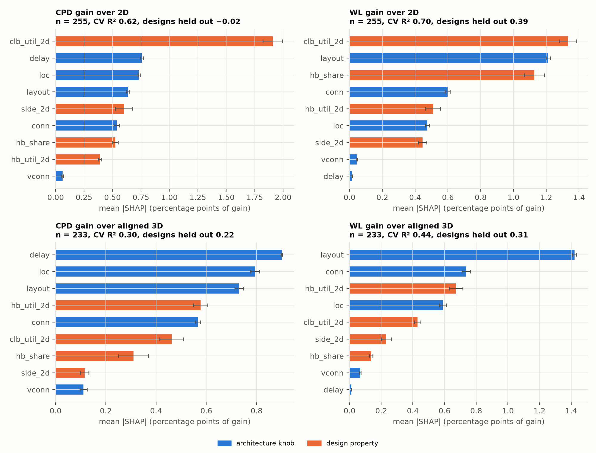

<!-- generated by campaign/shap_study.py from the study results; see shap_study.md -->

255 routed 3D configurations of 22 designs (conn 84, custom 9, layout 140, rq1 22). Features: knobs layout, conn, vconn, loc, delay; design properties hb_share, side_2d, clb_util_2d, hb_util_2d.

## Surrogate fit

| target | n | CV R² (10 splits) | designs held out | train R² | reading |
|---|---|---|---|---|---|
| cpd_vs2d_pct | 255 | 0.62 ± 0.04 | -0.02 ± 0.12 | 0.88 | fits the known designs, does not predict a new one |
| wl_vs2d_pct | 255 | 0.70 ± 0.04 | 0.39 ± 0.07 | 0.90 | good |
| cpd_vs3d_pct | 233 | 0.30 ± 0.08 | 0.22 ± 0.05 | 0.77 | weak: mostly seed noise |
| wl_vs3d_pct | 233 | 0.44 ± 0.05 | 0.31 ± 0.10 | 0.82 | moderate |

## Share of importance

Share of the summed mean |SHAP|; in brackets, the direction of a numeric parameter (Spearman of its value vs its SHAP value; layout and loc by category further down).

| parameter | kind | CPD gain over 2D | WL gain over 2D | CPD gain over aligned 3D | WL gain over aligned 3D |
|---|---|---|---|---|---|
| layout | knob | 10% | 21% | 16% | 33% |
| conn | knob | 9% (+0.75) | 10% (+0.75) | 12% (+0.77) | 17% (+0.77) |
| vconn | knob | 1% | 1% | 2% | 2% |
| loc | knob | 12% | 8% | 17% | 14% |
| delay | knob | 12% (-0.61) | 0% | 20% (-0.63) | 0% |
| hb_share | design | 9% (+0.05) | 20% (+0.77) | 7% (-0.50) | 3% |
| side_2d | design | 10% (-0.16) | 8% (+0.64) | 3% | 5% (-0.53) |
| clb_util_2d | design | 31% (-0.10) | 23% (-0.44) | 10% (-0.01) | 10% (-0.84) |
| hb_util_2d | design | 6% (-0.12) | 9% (+0.34) | 13% (-0.96) | 16% (-0.80) |

## CPD gain over 2D (cpd_vs2d_pct)

Average prediction +1.71 points; n = 255.

| parameter | kind | mean \|SHAP\| (points) | ± sd | share | direction |
|---|---|---|---|---|---|
| clb_util_2d | design | 1.91 | 0.09 | 31% | -0.10 |
| delay | knob | 0.76 | 0.01 | 12% | -0.61 |
| loc | knob | 0.73 | 0.01 | 12% | best: core (+1.35) |
| layout | knob | 0.64 | 0.01 | 10% | best: searched (+1.85) |
| side_2d | design | 0.60 | 0.08 | 10% | -0.16 |
| conn | knob | 0.54 | 0.02 | 9% | +0.75 |
| hb_share | design | 0.53 | 0.02 | 9% | +0.05 |
| hb_util_2d | design | 0.39 | 0.01 | 6% | -0.12 |
| vconn | knob | 0.06 | 0.01 | 1% | · |

- loc, mean SHAP by category: core +1.35, repeated_interval +0.37, rows +0.23, columns +0.05, perimeter -14.76
- layout, mean SHAP by category: searched +1.85, split_rev +0.54, staggered +0.40, split_types +0.39, aligned +0.23, hb_one_layer +0.12, hb_top -0.16, center_edges -0.62, edges -2.56, center -4.69

## WL gain over 2D (wl_vs2d_pct)

Average prediction +7.81 points; n = 255.

| parameter | kind | mean \|SHAP\| (points) | ± sd | share | direction |
|---|---|---|---|---|---|
| clb_util_2d | design | 1.33 | 0.05 | 23% | -0.44 |
| layout | knob | 1.21 | 0.01 | 21% | best: searched (+2.60) |
| hb_share | design | 1.13 | 0.06 | 20% | +0.77 |
| conn | knob | 0.60 | 0.02 | 10% | +0.75 |
| hb_util_2d | design | 0.51 | 0.05 | 9% | +0.34 |
| loc | knob | 0.47 | 0.01 | 8% | best: repeated_interval (+0.28) |
| side_2d | design | 0.44 | 0.03 | 8% | +0.64 |
| vconn | knob | 0.05 | 0.00 | 1% | · |
| delay | knob | 0.02 | 0.00 | 0% | · |

- layout, mean SHAP by category: searched +2.60, split_rev +1.87, split_types +1.55, hb_one_layer +0.21, hb_top +0.20, aligned +0.13, staggered +0.06, center_edges -2.94, center -4.97, edges -10.21
- loc, mean SHAP by category: repeated_interval +0.28, columns -0.13, rows -0.17, core -0.19, perimeter -8.72

## CPD gain over aligned 3D (cpd_vs3d_pct)

Average prediction -2.72 points; n = 233.

| parameter | kind | mean \|SHAP\| (points) | ± sd | share | direction |
|---|---|---|---|---|---|
| delay | knob | 0.90 | 0.00 | 20% | -0.63 |
| loc | knob | 0.79 | 0.02 | 17% | best: core (+1.98) |
| layout | knob | 0.73 | 0.02 | 16% | best: searched (+1.92) |
| hb_util_2d | design | 0.58 | 0.03 | 13% | -0.96 |
| conn | knob | 0.57 | 0.01 | 12% | +0.77 |
| clb_util_2d | design | 0.46 | 0.05 | 10% | -0.01 |
| hb_share | design | 0.31 | 0.06 | 7% | -0.50 |
| side_2d | design | 0.12 | 0.02 | 3% | · |
| vconn | knob | 0.11 | 0.01 | 2% | · |

- loc, mean SHAP by category: core +1.98, rows +0.68, columns +0.39, repeated_interval +0.36, perimeter -15.10
- layout, mean SHAP by category: searched +1.92, split_types +0.68, staggered +0.45, hb_one_layer +0.21, split_rev +0.20, aligned +0.05, hb_top -0.06, center_edges -0.45, edges -2.41, center -4.64

## WL gain over aligned 3D (wl_vs3d_pct)

Average prediction -1.19 points; n = 233.

| parameter | kind | mean \|SHAP\| (points) | ± sd | share | direction |
|---|---|---|---|---|---|
| layout | knob | 1.42 | 0.01 | 33% | best: searched (+2.61) |
| conn | knob | 0.74 | 0.03 | 17% | +0.77 |
| hb_util_2d | design | 0.67 | 0.04 | 16% | -0.80 |
| loc | knob | 0.59 | 0.02 | 14% | best: repeated_interval (+0.35) |
| clb_util_2d | design | 0.43 | 0.02 | 10% | -0.84 |
| side_2d | design | 0.23 | 0.03 | 5% | -0.53 |
| hb_share | design | 0.14 | 0.01 | 3% | · |
| vconn | knob | 0.07 | 0.00 | 2% | · |
| delay | knob | 0.01 | 0.00 | 0% | · |

- layout, mean SHAP by category: searched +2.61, split_rev +2.14, split_types +1.68, hb_one_layer +0.18, aligned +0.12, hb_top +0.03, staggered +0.02, center_edges -3.40, center -5.48, edges -11.55
- loc, mean SHAP by category: repeated_interval +0.35, core -0.20, columns -0.22, rows -0.26, perimeter -10.00

Direction: Spearman correlation between a numeric parameter's value and its SHAP value (+ = larger values raise the gain). Category values are mean SHAP values, i.e. relative to the average configuration in the study, not to the aligned reference. '·' = share below 5%.
